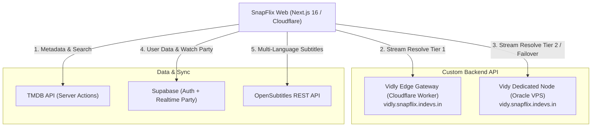

<h1 align="center">
  
  <br />
  SnapFlix Web
</h1>

<p align="center">
  <strong>Next-Gen Cinema Web Platform powered by Custom Dual-Tier Streaming API (Vidly Edge + Vidy Dedicated Node).</strong>
</p>

<p align="center">
  <a href="https://snapflix.indevs.in">
    
  </a>
  <a href="https://nextjs.org">
    
  </a>
  <a href="https://www.typescriptlang.org">
    
  </a>
  <a href="https://tailwindcss.com">
    
  </a>
  <a href="https://supabase.com">
    
  </a>
</p>

---

## 🌟 Overview

**SnapFlix Web** is a private, cinematic media streaming application designed with a high-contrast Netflix aesthetic. Built on **Next.js 16 (App Router / Turbopack)** and deployed on **Cloudflare Workers (OpenNext)**, SnapFlix provides a seamless catalog discovery and ultra-fast video playback experience.

Previously reliant on third-party client scrapers, SnapFlix now runs exclusively on its own **Custom Hybrid Streaming Backend API**:
1. **Tier-1 (`Vidly Edge Gateway`)**: Serverless edge resolver hosted on Cloudflare Workers delivering master multi-audio HLS streams and global media proxying.
2. **Tier-2 (`Vidy VPS Node`)**: Dedicated Oracle Cloud VPS running custom stream resolvers with Miami, Delhi, and Boise nodes, powering multi-audio fallbacks and 4K/1080p playback.

---

## ✨ Key Features

### 🎬 Cinema Experience & Discovery
- **Netflix Design System**: Dynamic Hero Billboard, top-rated trending rows, and "Top 10" badges.
- **Instant Search**: Real-time server-side TMDB discovery across movies, series, actors, and genres.
- **Server-Side Metadata Protection**: TMDB API keys and authentication tokens are kept strictly server-side.
- **Personal Watchlist & History**: Cloud-synchronized watch history and continue-watching state via Supabase.

### ⚡ Custom Streaming Engine (`SnapFlix API`)
- **Direct Dual-Tier Streaming**:
  - **Primary**: `https://vidly.snapflix.indevs.in` (Vidly Edge Gateway).
  - **Secondary / Fallback**: `https://vidy.snapflix.indevs.in` (Vidy VPS Node).
- **Smart Failover**: Automatic seamless recovery to secondary nodes if an upstream stream stalls or encounters errors.
- **Zero CORS / ISP Bypass**: Universal edge stream proxying for video chunks, keys, and master playlists.

### 🎥 Native Pro Web Player (`NativeWebPlayer`)
- **Dual Server Switcher**: Toggle between `SnapFlix Fast (Vidly)` and `SnapFlix Vidy (VPS)` on the fly with automatic timestamp and audio state preservation.
- **Adaptive Multi-Bitrate**: HLS resolution selector (`Auto`, `4K`, `1080p`, `720p`, `480p`, `360p`).
- **Multi-Audio Language Selection**: Real-time audio switching with **Hindi audio prioritized as default** when available.
- **Universal Subtitles System**:
  - Automatically fetches matching subtitles from OpenSubtitles in the background for any title.
  - Cross-server subtitle sharing so subtitles stay active when switching between Vidly and Vidy.
  - **Dynamic Letterbox Anchoring**: Subtitles sit comfortably 1-2px below the movie frame into the black bar with zero visual overlap.
  - **Flag & Language Identification**: Accurate language detection with country flags (🇮🇳 Hindi, 🇬🇧 English, 🇪🇸 Spanish, 🇭🇷 Croatian, etc.).
  - Custom subtitle appearance controls (Font size, Text color, Background style).
- **Watch Party (Supabase Realtime)**:
  - Synchronized group playback (Play, Pause, Seek).
  - Live chat drawer with animated floating reactions.
- **Keyboard & Gesture Controls**: Complete hotkey bindings (Space/K for play, J/L for 10s seek, F for fullscreen, M for mute) and touch-friendly mobile bottom drawers.

---

## 🛠️ Architecture



---

## 💻 Tech Stack

| Domain | Technologies |
| :--- | :--- |
| **Framework** | [Next.js 16.4.3 (App Router)](https://nextjs.org/) & React 19 |
| **Language** | [TypeScript 5.x](https://www.typescriptlang.org/) |
| **Styling** | [Tailwind CSS 4](https://tailwindcss.com/) & Lucide React Icons |
| **Player & Video** | [Hls.js](https://github.com/video-dev/hls.js/) + Native HTML5 Media Tracks |
| **Backend Deployment** | [Cloudflare Workers](https://workers.cloudflare.com/) via OpenNext (`@opennextjs/cloudflare`) |
| **Database & Realtime**| [Supabase](https://supabase.com/) (PostgreSQL, Auth, Realtime Channels) |
| **Metadata & Media** | [The Movie Database (TMDB)](https://www.themoviedb.org/) & OpenSubtitles |

---

## 🚀 Getting Started

### 1. Clone & Install
```bash
git clone https://github.com/ansarixfarhan/SnapFlix.git
cd SnapFlix/SnapFlix-Web
npm install
```

### 2. Environment Variables
Create `.env.local` based on `.env.example`:

```env
# TMDB API (Server-Side)
TMDB_ACCESS_TOKEN="your_tmdb_read_access_token"
NEXT_PUBLIC_TMDB_ACCESS_TOKEN="your_tmdb_read_access_token"

# Custom Streaming APIs
NEXT_PUBLIC_BACKEND_URL="https://vidly.snapflix.indevs.in"
NEXT_PUBLIC_BACKEND_URL_TIER2="https://vidy.snapflix.indevs.in"

# Supabase Auth & Realtime
NEXT_PUBLIC_SUPABASE_URL="https://your-project.supabase.co"
NEXT_PUBLIC_SUPABASE_ANON_KEY="your-anon-key"
```

> The separate mobile metadata API requires the server-only
> `TMDB_ACCESS_TOKEN` and does not use public/fallback TMDB credentials. See
> [Mobile API documentation](docs/mobile-api.md).

### 3. Local Development
```bash
npm run dev
```
Open [http://localhost:3000](http://localhost:3000) to view the application.

### 4. Production Deployment (Cloudflare Workers)
SnapFlix Web builds and deploys directly to Cloudflare via OpenNext and Wrangler:
```bash
npm run deploy
```

### 5. Mobile Metadata API

The mobile app has its own versioned TMDB metadata API under
`/api/mobile/v1/`: home, list, search, details, episodes, episode groups,
genre Discover, genre lists and IMDb-to-TMDB lookup. It uses only the
server-side `TMDB_ACCESS_TOKEN`, fixed TMDB paths, strict input validation,
layered caching and request-rate protection. Home returns partial results if a
single row fails, and the optional app-key gate disables public CDN caching so
it cannot be bypassed by a cache hit. The existing provider/stream resolver and
website playback are unchanged.

Endpoint contracts, Cloudflare secret/cache/WAF setup and targeted test
commands are documented in [docs/mobile-api.md](docs/mobile-api.md).

```bash
npm run test:mobile-api
npm run typecheck:mobile
npm run typecheck
```

---

## 📄 License & Credits

SnapFlix Web is developed and maintained by **[Farhan Ansari](https://github.com/ansarixfarhan)**.  
All rights reserved. Proprietary software built for private entertainment and playback.

---

<p align="center">
  Crafted with ❤️ by <a href="https://github.com/ansarixfarhan"><strong>Farhan Ansari</strong></a>
</p>
